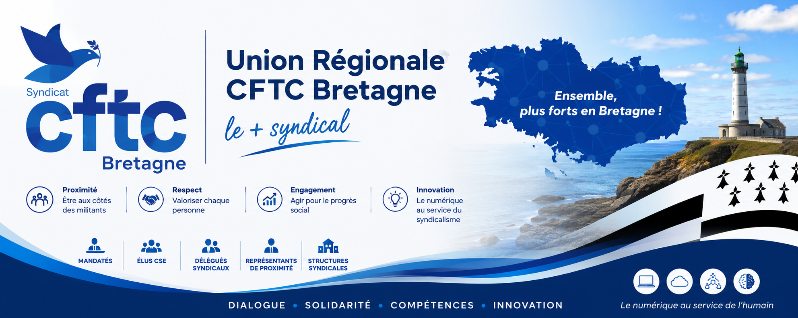

  

  

  # Union régionale CFTC Bretagne
  **Le numérique au service de l'engagement syndical, du dialogue social et des territoires**

  
  
  

---

## Bienvenue

Cet espace GitHub rassemble les **initiatives numériques de l'Union régionale CFTC Bretagne**. Notre ambition : développer des outils simples, utiles et durables pour soutenir l'action des structures syndicales, faciliter le travail des mandatés et favoriser le partage de connaissances.

La technologie est un moyen, non une fin : chaque projet doit répondre à un besoin concret du terrain, rester accessible à ses utilisateurs et respecter la confidentialité des informations syndicales.

## À qui s'adressent ces projets ?

- Aux **unions départementales et locales** et aux **syndicats professionnels** ;
- Aux **sections syndicales**, **élus CSE** et **délégués syndicaux** ;
- Aux **mandatés** siégeant dans les instances de dialogue social et de protection sociale ;
- Aux **responsables et équipes régionales** chargés d'animer ces réseaux.

## Nos axes de travail

| Axe | Finalité | État |
| --- | --- | --- |
| 👥 Annuaire régional des mandatés | Identifier les mandats, faciliter la coordination et anticiper les renouvellements | Projet |
| 📅 Suivi des instances et échéances | Structurer les réunions, échéances et comptes rendus | Projet |
| 📚 Ressources documentaires | Organiser et rendre accessibles les ressources utiles à l'action syndicale | Projet |
| 📊 Observatoire régional | Mettre à disposition des analyses socio-économiques utiles aux mandatés | Projet |
| 🤖 Assistant IA CFTC Bretagne | Explorer des usages responsables de l'IA pour accompagner les responsables | Projet |

*Les intitulés et états ci-dessus décrivent des orientations de travail, et non des services déjà déployés.*

## Notre méthode : des projets utiles et pilotés

Nous privilégions deux cadres complémentaires :

**SMART** — définir des objectifs spécifiques, mesurables, atteignables, réalistes et temporellement définis.

**RACI** — clarifier les rôles : **R** (réalise), **A** (rend compte et valide), **C** (consulté), **I** (informé).

Chaque initiative doit préciser son besoin, ses bénéficiaires, son responsable, ses livrables, ses moyens et ses critères de réussite. Les décisions institutionnelles relèvent des instances compétentes de l'UR CFTC Bretagne.

## Nos principaux dépôts

Les dépôts ci-dessous sont présentés par domaine d'usage, **sans classement de popularité**. Leur présence ne signifie pas qu'un service est déjà disponible en production.

| Dépôt | Domaine | Accès |
| --- | --- | --- |
| **[cftc-mandats](https://github.com/UR-CFTC-Bretagne/cftc-mandats)** | Outils autour de la gestion des mandats | Public |
| **[cftc-mandats-paritaires](https://github.com/UR-CFTC-Bretagne/cftc-mandats-paritaires)** | Outils relatifs aux mandats paritaires | Public |
| **[fiche-de-frais](https://github.com/UR-CFTC-Bretagne/fiche-de-frais)** | Outils de gestion des frais | Public |
| **[compte-rendus](https://github.com/UR-CFTC-Bretagne/compte-rendus)** | Outils relatifs aux comptes rendus | Public |
| **[ur-cftc-bretagne](https://github.com/UR-CFTC-Bretagne/ur-cftc-bretagne)** | Espace de développement régional (dépôt actuellement vide) | Public |
| **[.github](https://github.com/UR-CFTC-Bretagne/.github)** | Présentation de l'organisation | Public |

## L'organisation en chiffres

*Chiffres constatés le 25 octobre 2026. Les badges ci-dessus sont statiques et doivent être actualisés lorsque l'organisation évolue.*

### Activité et suivi des projets

Pour consulter les données à jour, GitHub fournit directement les indicateurs par dépôt :

- **Stars** : intérêt exprimé par les utilisateurs ;
- **Forks** : copies destinées notamment aux contributions ;
- **Issues** : demandes, anomalies et travaux suivis ;
- **Pull requests** : propositions de modifications ;
- **Commits** : historique des évolutions.

➡️ **[Explorer tous les dépôts et leurs indicateurs](https://github.com/orgs/UR-CFTC-Bretagne/repositories)**

Ces indicateurs mesurent l'activité technique ; ils ne remplacent pas les indicateurs d'utilité syndicale, d'adoption ou de qualité de service.

## Dépôts et organisation

- **[ur-cftc-bretagne](https://github.com/UR-CFTC-Bretagne/ur-cftc-bretagne)** : dépôt destiné aux développements numériques de l'Union régionale.
- **[.github](https://github.com/UR-CFTC-Bretagne/.github)** : présentation publique de l'organisation et, à terme, règles communes de contribution.

Les outils Google Workspace peuvent soutenir la gestion documentaire et opérationnelle. **GitHub n'a pas vocation à remplacer les espaces internes sécurisés.**

## Proposer une idée ou contribuer

Vous souhaitez améliorer un processus ou proposer un outil ?

1. Consultez les projets existants pour éviter les doublons.
2. [Ouvrez une proposition](https://github.com/UR-CFTC-Bretagne/.github/issues/new) en présentant le besoin, les utilisateurs concernés et le bénéfice attendu.
3. Précisez, si possible, les contraintes, ressources et échéances.
4. La proposition pourra être étudiée selon son utilité, sa faisabilité, son coût, son impact et sa cohérence avec les orientations régionales.

**Ne publiez aucune donnée personnelle, pièce confidentielle ou information syndicale sensible dans une issue publique.** Vous pouvez aussi nous contacter directement par courriel.

## Confidentialité et usage responsable

- Ne jamais déposer dans un dépôt public des listes nominatives de mandatés, coordonnées privées, données d'adhésion, documents internes confidentiels ou identifiants d'accès.
- Appliquer le principe de minimisation des données et prévoir des droits d'accès adaptés.
- Vérifier les contenus produits avec l'IA avant toute utilisation ou diffusion.
- Privilégier des solutions documentées, maintenables et accessibles.

## Contact

**Union régionale CFTC Bretagne**  
📍 Rennes · Bretagne · France  
✉️ **bretagne@cftc.fr**  
🌐 [Confédération CFTC](https://www.cftc.fr)

---

<strong>Agir ensemble, partager les compétences, renforcer le dialogue social.</strong>

